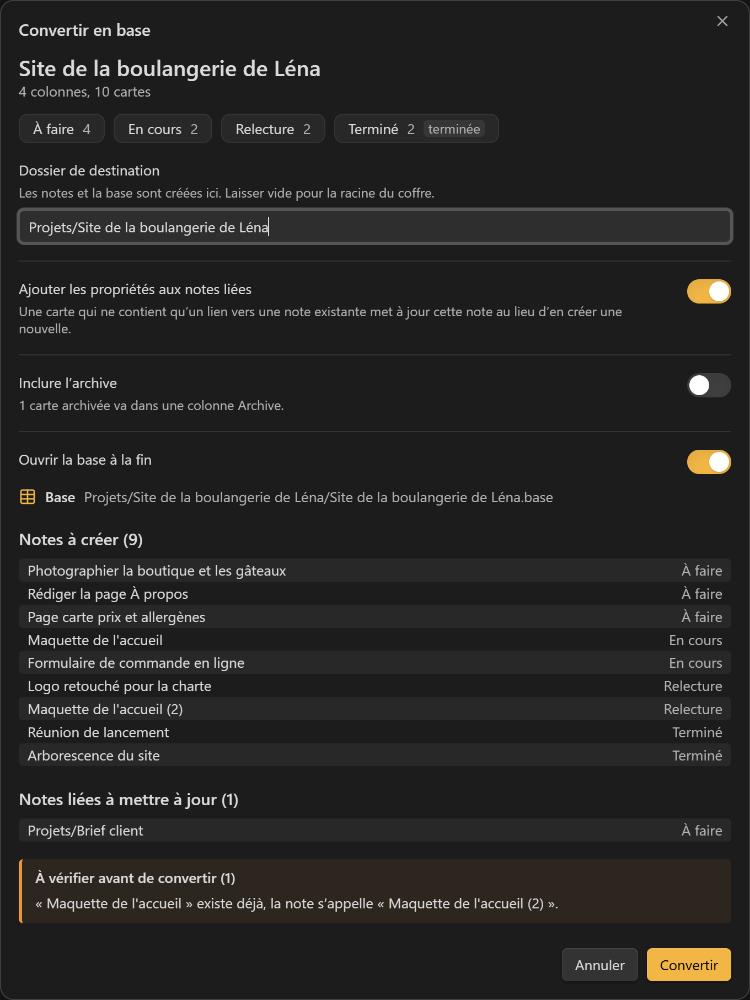
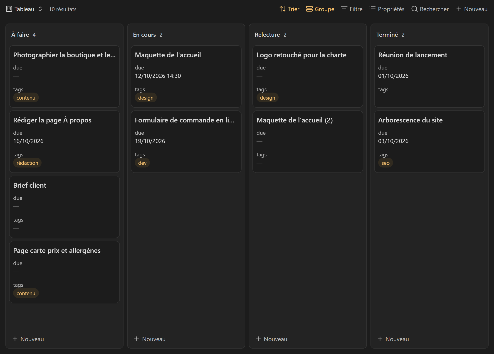
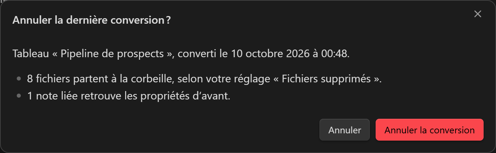
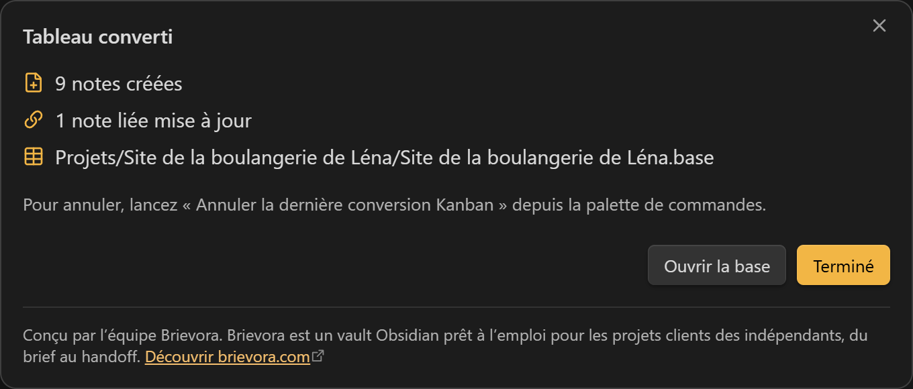
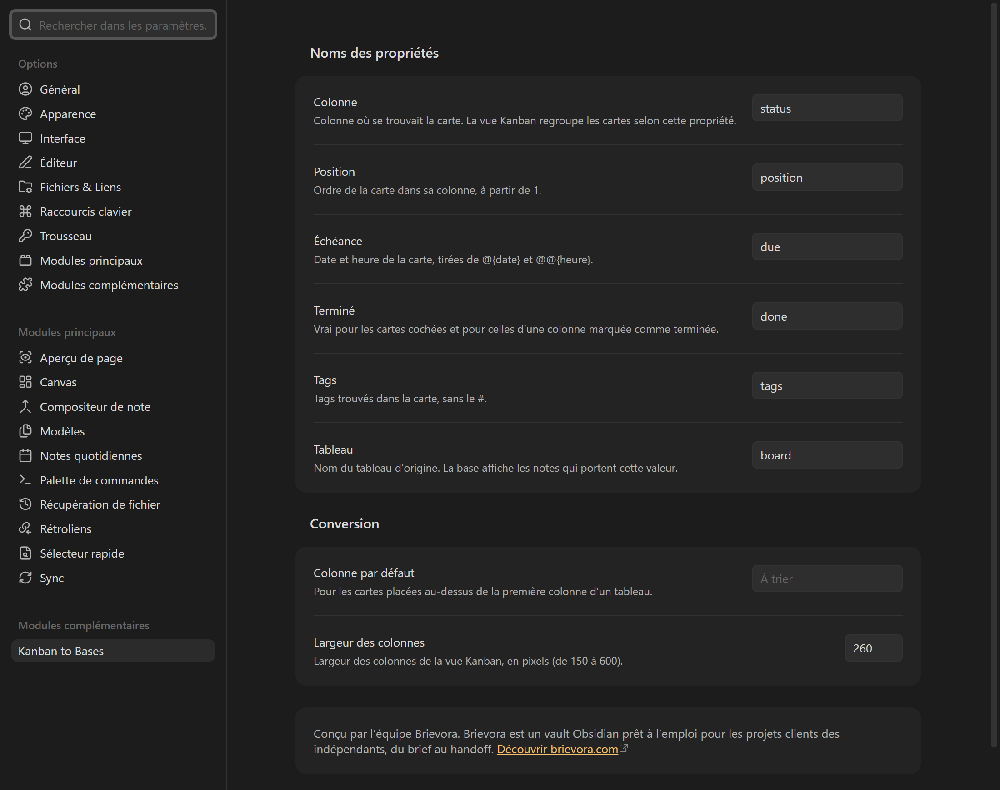

# Kanban to Bases

[English](README.md)

Kanban to Bases transforme un tableau créé avec le [plugin communautaire Kanban](https://github.com/community-archive/obsidian-kanban) en une note par carte et un fichier `.base` qui s’ouvre dans la vue Kanban intégrée à Obsidian 1.14.

Le plugin Kanban range tout un tableau dans un seul fichier Markdown. Obsidian 1.14 a ajouté à Bases une vue Kanban native, où chaque carte est une note et chaque colonne une valeur de propriété. Ce plugin fait passer un tableau du premier format au second. Le fichier du tableau d’origine n’est jamais modifié.



## Ce que vous obtenez



- Une note par carte, dans un dossier qui porte le nom du tableau.
- Un fichier `.base` avec deux vues : **Tableau** (Kanban, colonnes dans l’ordre d’origine) et **Toutes les cartes** (table).
- Les cartes qui ne contiennent qu’un lien vers une note existante, comme `[[Brief client]]`, mettent à jour cette note au lieu d’en créer une copie.
- Une commande d’annulation qui retire tout ce que la dernière conversion a créé.

## Utilisation

1. Ouvrez un tableau Kanban et cliquez sur le bouton **Convertir en base**, en haut à droite de la note. La même action se trouve dans la palette de commandes (**Convertir ce tableau Kanban en base**) et dans le menu du clic droit sur le tableau, dans l’explorateur de fichiers.
2. Vérifiez l’aperçu : colonnes, notes à créer, notes liées à mettre à jour, points à vérifier. Changez le dossier de destination ou les options si besoin.
3. Cliquez sur **Convertir**. La base s’ouvre dans un nouvel onglet.

La commande n’apparaît que si le fichier actif est un tableau Kanban (une note avec `kanban-plugin` dans ses propriétés).

## Des cartes aux notes

| Dans le tableau | Dans la note |
| --- | --- |
| Titre de la colonne, sans sa limite `(N)` | `status` |
| Rang de la carte dans sa colonne, à partir de 1 | `position` |
| `@{2026-10-12}`, `@[[2026-10-12]]`, `@@{14:30}` | `due` (`2026-10-12` ou `2026-10-12T14:30`) |
| Case cochée, ou colonne marquée **Complete** | `done: true` |
| `#tags` | `tags` (sans le `#`) |
| Nom du fichier du tableau | `board` |
| Champs `clé:: valeur` et `[clé:: valeur]` | une propriété du même nom |
| Première ligne, sans dates, tags, identifiants de bloc ni mise en forme | nom de la note |
| Autres lignes (et retours `<br>`) | corps de la note |

Précisions :

- Les dates sont lues avec les réglages du tableau (`date-trigger`, `time-trigger`, `date-format`, `time-format`), ou avec ceux du plugin Kanban quand le tableau n’en a pas. Une date qui ne suit pas le format reste dans le texte et apparaît dans les points à vérifier.
- Les caractères interdits dans un nom de fichier (`* " \ / < > : | ? # ^ [ ]`) sont retirés. Un nom de plus de 100 caractères est coupé sur un mot, et la première ligne complète est gardée en tête de la note. Les noms en double reçoivent un suffixe : `Maquette de l'accueil (2)`.
- L’archive (la partie qui suit `***` en fin de tableau) est laissée de côté par défaut. Si vous l’incluez, ses cartes vont dans une colonne de plus, qui porte le titre de l’archive.
- Une carte qui renvoie à une note qui n’existe pas encore crée une note de ce nom : le lien du tableau mène alors quelque part.
- Une carte qui ne contient qu’un lien vers un fichier qui n’est pas une note (un PDF, une image) devient une note nommée d’après ce fichier, avec le lien en tête.
- Sur une note liée, seules `status`, `position` et `board` sont écrites. Ses autres propriétés ne changent pas. L’aperçu montre l’ancienne valeur de `status` quand elle change, et prévient quand la date, les étiquettes ou les champs de la carte ne sont pas copiés.
- Quand d’autres notes portent déjà le nom du tableau (un autre tableau du même nom, ou une conversion précédente), `board` reçoit aussi le dossier du tableau, par exemple `Kanban (Projets/B)`. Chaque base ne montre ainsi que ses propres cartes.

Les noms des propriétés se règlent dans les paramètres du plugin.

## Annuler



**Annuler la dernière conversion Kanban** demande confirmation, puis :

- envoie à la corbeille les notes et la base créées par la dernière conversion, selon votre réglage **Fichiers & Liens › Fichiers supprimés** ;
- rend aux notes liées les propriétés qu’elles avaient avant. Une propriété modifiée après la conversion est conservée telle quelle ;
- supprime les dossiers créés par la conversion, s’ils sont vides.

Seule la dernière conversion peut être annulée. La liste de ce qu’elle a créé est gardée dans les données du plugin : l’annulation fonctionne encore après un redémarrage d’Obsidian.



## Paramètres



- **Noms des propriétés** : `status`, `position`, `due`, `done`, `tags` et `board` par défaut.
- **Colonne par défaut** : la colonne des cartes placées au-dessus de la première colonne d’un tableau (le plugin Kanban ne les affiche pas).
- **Largeur des colonnes** : largeur des colonnes dans la vue Kanban créée, 260 pixels par défaut.

## Limites connues

- Déplacer une carte dans une autre colonne de la vue Kanban met à jour son `status`. La déplacer à l’intérieur d’une colonne ne change pas `position` : l’ordre suit les valeurs de `position`.
- La vue Kanban n’affiche que les colonnes listées dans la base. Une note avec une nouvelle valeur de `status` reste cachée tant que cette colonne n’est pas ajoutée à la vue.
- Les réglages enregistrés dans le plugin Kanban lui-même sont lus dans `.obsidian/plugins/obsidian-kanban/data.json` quand ce fichier existe. Les formats de cartes d’autres plugins ne sont pas convertis, sauf la date d’échéance du plugin Tasks (`📅 2026-10-12`).

## Confidentialité et réseau

Le plugin ne fait aucune requête réseau et ne collecte aucune donnée d’usage. Il lit et écrit seulement des fichiers de votre coffre, par l’API d’Obsidian, et fonctionne sur mobile.

## À propos de Brievora

L’onglet des paramètres et la fenêtre affichée après une conversion contiennent un court encart statique : « Conçu par l’équipe Brievora. Brievora est un vault Obsidian prêt à l’emploi pour les projets clients des indépendants, du brief au handoff. », avec un lien vers [brievora.com](https://brievora.com/fr?utm_source=obsidian&utm_medium=plugin&utm_campaign=kanban-to-bases). Cet encart fait partie de l’interface du plugin. Rien n’est chargé depuis internet, et le lien ne s’ouvre que si vous cliquez dessus.

## Installation

Depuis Obsidian : **Paramètres › Modules complémentaires › Parcourir**, cherchez « Kanban to Bases », installez-le puis activez-le. Obsidian 1.14 ou plus récent est nécessaire.

Installation manuelle : téléchargez `main.js`, `manifest.json` et `styles.css` depuis la [dernière version](https://github.com/brievora/kanban-to-bases/releases), placez-les dans `<votre coffre>/.obsidian/plugins/kanban-to-bases/`, puis activez le plugin dans **Paramètres › Modules complémentaires**.

## Développement

```sh
pnpm install
pnpm test        # tests unitaires de l'analyseur de tableaux et de l'écriture du .base
pnpm build       # vérification des types, puis main.js
pnpm lint        # ESLint avec eslint-plugin-obsidianmd
```

L’analyseur a été écrit à partir des fichiers de tableaux produits par le plugin Kanban. Il ne reprend aucun code de ce plugin.

Bogues et idées : [github.com/brievora/kanban-to-bases/issues](https://github.com/brievora/kanban-to-bases/issues).

## Licence

[MIT](LICENSE), © 2026 Brievora. Ce plugin n’est édité ni par l’équipe d’Obsidian ni par les auteurs du plugin Kanban.
