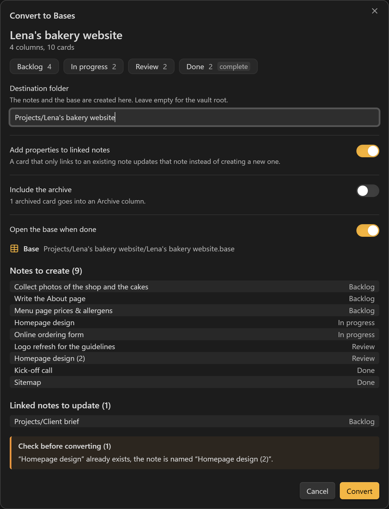
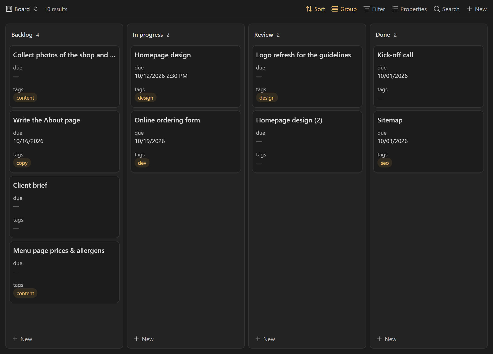
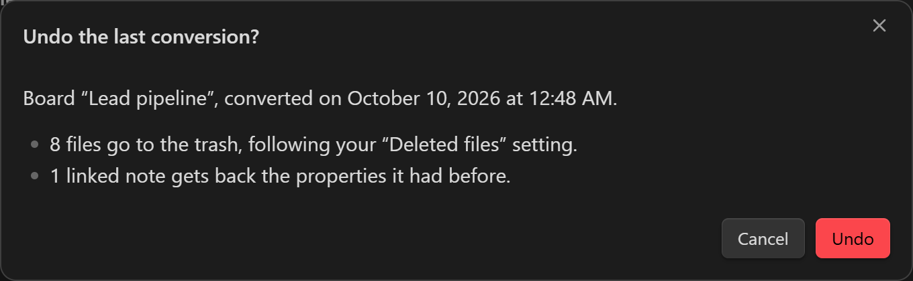
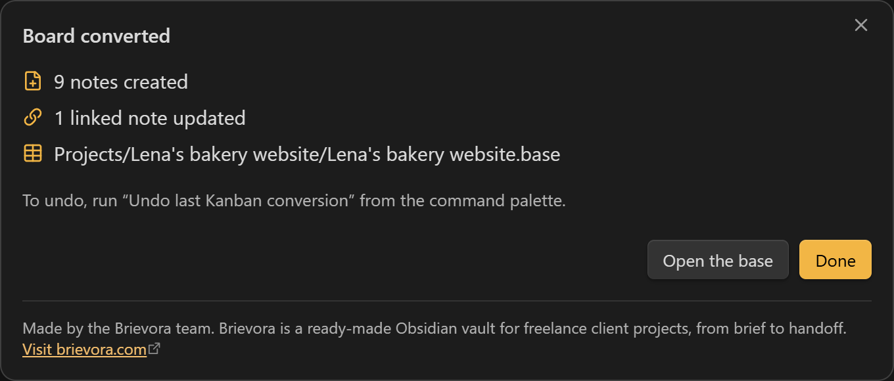
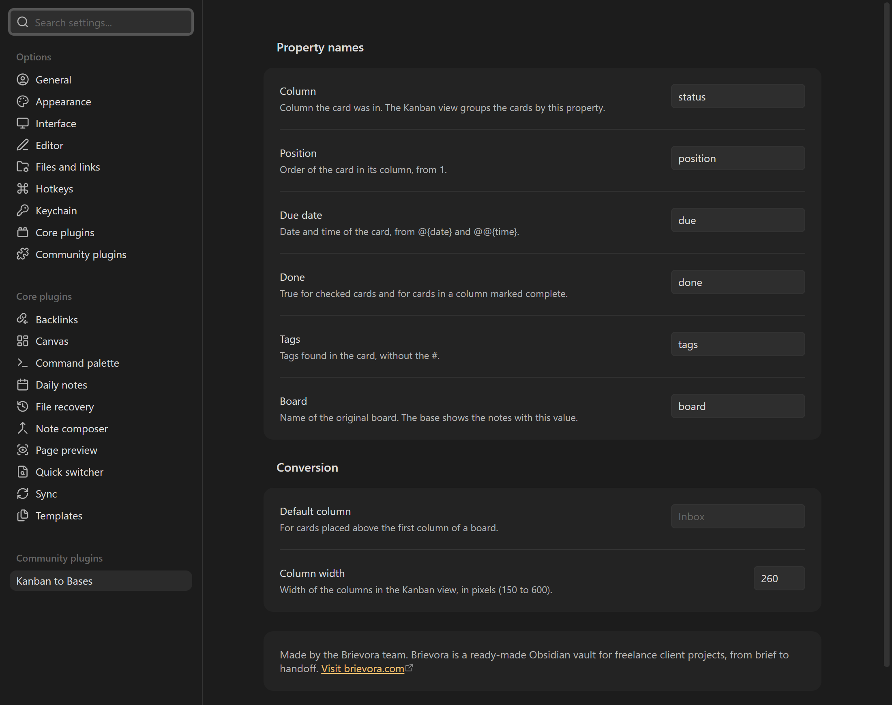

# Kanban to Bases

[Français](README.fr.md)

Kanban to Bases turns a board made with the community [Kanban plugin](https://github.com/community-archive/obsidian-kanban) into one note per card and a `.base` file that opens in the Kanban view built into Obsidian 1.14.

The Kanban plugin keeps a whole board in a single Markdown file. Obsidian 1.14 added a native Kanban view to Bases, where each card is a note and each column is a property value. This plugin moves a board from the first format to the second. The original board file is never modified.



## What you get



- One note per card, in a folder named after the board.
- A `.base` file with two views: **Board** (Kanban, columns in the original order) and **All cards** (table).
- Cards that only link to an existing note, such as `[[Client brief]]`, update that note instead of creating a copy.
- An undo command that removes everything the last conversion created.

## How to use it

1. Open a Kanban board and click the **Convert to Bases** button at the top right of the note. The command palette has the same action (**Convert this Kanban board to Bases**), and so does the right-click menu of the board in the file explorer.
2. Check the preview: columns, notes to create, linked notes to update, warnings. Change the destination folder or the options if needed.
3. Select **Convert**. The base opens in a new tab.

The command only shows when the active file is a Kanban board (a note with `kanban-plugin` in its frontmatter).

## How cards become notes

| On the board | In the note |
| --- | --- |
| Column heading, without its `(N)` card limit | `status` |
| Order of the card in its column, from 1 | `position` |
| `@{2026-10-12}`, `@[[2026-10-12]]`, `@@{14:30}` | `due` (`2026-10-12` or `2026-10-12T14:30`) |
| Checked box, or a column marked **Complete** | `done: true` |
| `#tags` | `tags` (without the `#`) |
| Board file name | `board` |
| `key:: value` and `[key:: value]` fields | a property with the same name |
| First line, cleaned of dates, tags, block IDs and Markdown | note name |
| Other lines (and `<br>` line breaks) | note body |

Details:

- Dates are read with the board's own settings (`date-trigger`, `time-trigger`, `date-format`, `time-format`), or with the Kanban plugin's defaults when the board has none. A date that does not match the format stays in the text and shows up as a warning.
- Characters that a file name cannot hold (`* " \ / < > : | ? # ^ [ ]`) are removed. Names longer than 100 characters are cut at a word, and the full first line is kept at the top of the note. Duplicate names get a suffix: `Homepage design (2)`.
- The archive (the section after `***` at the end of the board) is left out by default. When you include it, its cards go into an extra column with the archive heading as its name.
- A card linking to a note that does not exist yet creates a note with that name, so the link on the board now leads somewhere.
- A card that only links to a file that is not a note (a PDF, an image) becomes a note named after that file, with the link at the top.
- For a linked note, only `status`, `position` and `board` are written. Its other properties stay as they are. The preview shows the old `status` when it changes, and warns when the date, tags or fields of the card are not copied.
- When other notes already carry the board name (another board with the same name, or an earlier conversion), `board` also gets the board's folder, for example `Kanban (Projects/B)`, so each base only shows its own cards.

Property names can be changed in the settings.

## Undo



**Undo last Kanban conversion** asks for confirmation, then:

- moves the notes and the base created by the last conversion to the trash, following your **Files and links › Deleted files** setting;
- gives linked notes back the properties they had before. A property you edited after the conversion is kept as is;
- removes the folders the conversion created, if they are empty.

Only the last conversion can be undone. The list of what it created is kept in the plugin's data, so undo still works after restarting Obsidian.



## Settings



- **Property names**: `status`, `position`, `due`, `done`, `tags` and `board` by default.
- **Default column**: where cards placed above the first column of a board go (Kanban does not show them).
- **Column width**: width of the columns in the generated Kanban view, 260 pixels by default.

## Known limits

- Moving a card to another column in the Kanban view updates its `status`. Moving a card inside a column does not change `position`, so the order follows the `position` values.
- The Kanban view only shows the columns listed in the base. A note with a new `status` value stays hidden until that column is added to the view.
- Settings stored in the Kanban plugin itself are read from `.obsidian/plugins/obsidian-kanban/data.json` when that file exists. Other plugins' card formats are not converted, except the due date of the Tasks plugin (`📅 2026-10-12`).

## Privacy and network

The plugin makes no network request and has no telemetry. It only reads and writes files in your vault, through the Obsidian API, and works on mobile.

## Note about Brievora

The settings tab and the dialog shown after a conversion contain a short static note: "Made by the Brievora team. Brievora is a ready-made Obsidian vault for freelance client projects, from brief to handoff." with a link to [brievora.com](https://brievora.com/?utm_source=obsidian&utm_medium=plugin&utm_campaign=kanban-to-bases). The note is part of the plugin's own interface. Nothing is loaded from the internet, and the link only opens when you select it.

## Installation

From Obsidian: **Settings › Community plugins › Browse**, search for "Kanban to Bases", then install and enable it. Obsidian 1.14 or later is required.

Manual installation: download `main.js`, `manifest.json` and `styles.css` from the [latest release](https://github.com/brievora/kanban-to-bases/releases), put them in `<your vault>/.obsidian/plugins/kanban-to-bases/`, then enable the plugin in **Settings › Community plugins**.

## Development

```sh
pnpm install
pnpm test        # unit tests of the board parser and the .base writer
pnpm build       # type check, then main.js
pnpm lint        # ESLint with eslint-plugin-obsidianmd
```

The parser was written from the board files the Kanban plugin produces. It shares no code with that plugin.

Bug reports and ideas: [github.com/brievora/kanban-to-bases/issues](https://github.com/brievora/kanban-to-bases/issues).

## License

[MIT](LICENSE), © 2026 Brievora. This plugin is not made by the Obsidian team or by the authors of the Kanban plugin.
